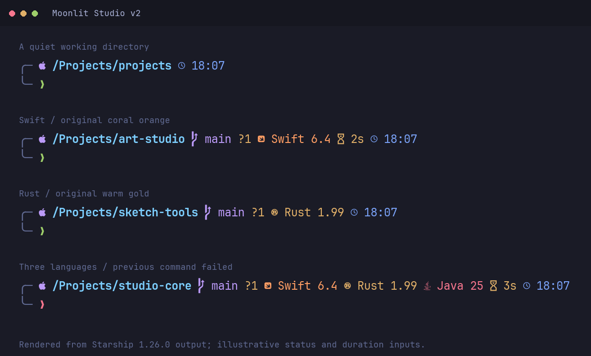
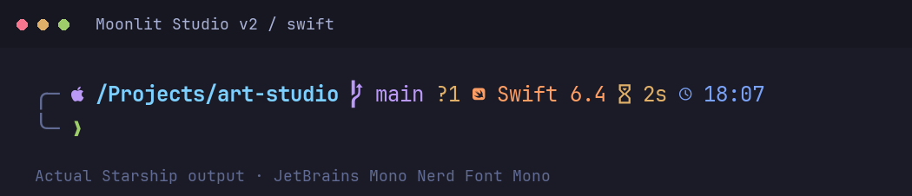
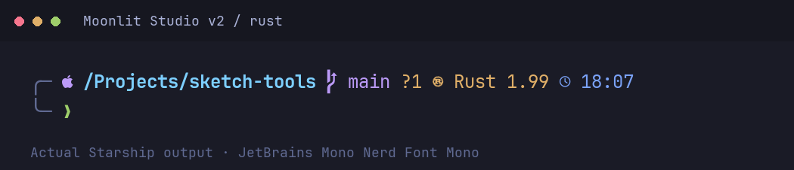
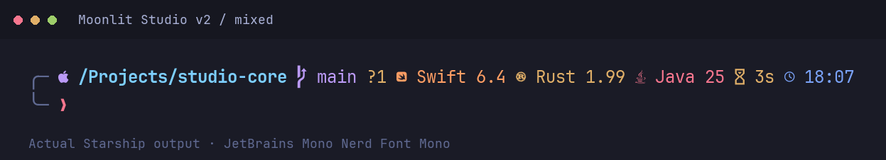
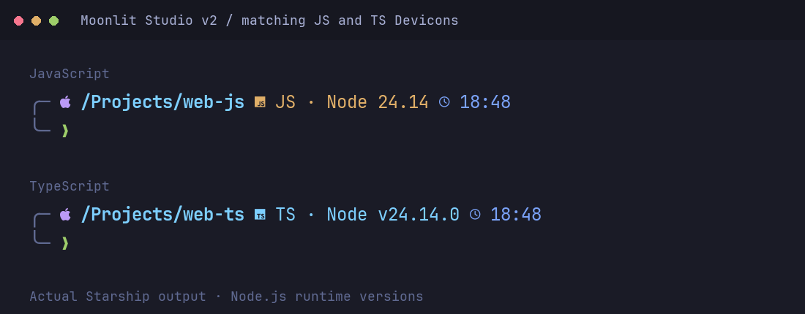

# Moonlit Studio v2

A quiet, two-line [Starship](https://starship.rs/) prompt for a moonlit workspace.

Moonlit Studio keeps its original layout and colors: an ice-blue directory,
lavender Git branch, warm Git status markers, and a green or coral prompt arrow.
Version 2 adds language-specific Nerd Font icons and support for 15 common
languages without changing the visual identity of v1.



The previews are rendered from actual Starship output using JetBrains Mono Nerd
Font Mono. They use anonymous demo paths and real installed Swift, Rust, and Java
versions; the JS/TS preview shows an installed Node.js version. Exit status and command duration are illustrative inputs supplied to
Starship. These are rendered previews, not Terminal.app screenshots.

## Features

- The original `╭─` / `╰─` layout, with no background color blocks.
- Language icons, names, and available toolchain versions.
- Multiple languages in the same directory, with conservative detection rules.
  **All matching languages can display; there is no three-language cap or `+N` counter.**
- Git branch and status, abbreviated paths, local time, and durations from two seconds.
- A single TOML file: no helper scripts or separate theme runtime to install.

| Swift | Rust | Mixed languages |
| --- | --- | --- |
|  |  |  |

JS and TS use matching Devicons and keep their own colors:



## Requirements

- A recent Starship release. This configuration was verified with **1.26.0**.
- Zsh and a terminal with true-color support. macOS Terminal.app is the intended setup.
- A patched Nerd Font installed **and selected in the terminal**; Nerd Fonts **3.5.1**
  is the tested baseline for the matching JS/TS Devicons.
- The relevant compiler or runtime on `PATH` when you want its version displayed.

Oh My Zsh is optional. The theme itself does not require Python or Node.js as a
configuration engine. Language modules query their own installed tools; JS and TS
version displays use Node.js. No toolchains are installed by this theme.

## Install

Download and extract the project, then open a shell in the `moonlit-studio` folder.
If Starship is already working, skip the installation and shell setup steps.

### 1. Install Starship

On macOS with Homebrew:

```sh
brew install starship
```

For other platforms, follow the [official installation guide](https://starship.rs/guide/#installation).

### 2. Select a Nerd Font

Install [JetBrains Mono Nerd Font](https://www.nerdfonts.com/font-downloads).
In Terminal.app, open **Settings → Profiles → Text → Font → Change** and select
**JetBrainsMono Nerd Font** or **JetBrainsMono Nerd Font Mono**. The exact family
label can vary by font release.

The **Mono** variant is recommended because its icons occupy one character cell.
Avoid the **Propo** variant for a terminal prompt. Plain JetBrains Mono is not
patched and does not provide these icons.

All 15 language glyphs and their single-cell advances were checked in both
JetBrains Mono Nerd Font and its Mono variant, version **3.5.1**. Other fonts and older Nerd Fonts releases may render
icons differently; update the font if a glyph is missing. The terminal background
belongs to your terminal profile, not this TOML. Keep your existing dark-blue
profile; the preview uses `#1A1B26` as an illustrative background.

### 3. Initialize Zsh

If using Oh My Zsh, put this after the line that loads Oh My Zsh in `~/.zshrc`:

```sh
eval "$(starship init zsh)"
```

Use one Starship initialization line, at the end of your prompt setup. Avoid loading
another prompt manager after it. If Starship already initializes correctly, keep
your existing setup.

### 4. Try the theme before replacing anything

From the extracted project folder:

```sh
STARSHIP_CONFIG="$PWD/starship.toml" starship prompt
STARSHIP_CONFIG="$PWD/starship.toml" zsh -i
```

The second command opens a temporary shell with the theme. Run `exit` to return to
your previous shell. It does not replace your configuration. A `STARSHIP_CONFIG`
assignment inside your shell startup files can override this temporary selection.

### 5. Back up, then install

These commands target Starship's default configuration location. If you already
use a custom `STARSHIP_CONFIG` path, back up and update that file instead.

```sh
mkdir -p "$HOME/.config"
moonlit_backup="$HOME/.config/starship.toml.backup-$(date +%Y%m%d-%H%M%S)"
if [ -f "$HOME/.config/starship.toml" ]; then
    cp -p "$HOME/.config/starship.toml" "$moonlit_backup" &&
    echo "Backup saved to: $moonlit_backup" &&
    cp ./starship.toml "$HOME/.config/starship.toml"
else
    cp ./starship.toml "$HOME/.config/starship.toml"
fi
```

Keep the printed backup filename. Start a new terminal session after installation.
If you set `STARSHIP_CONFIG` elsewhere, ensure it points to the installed file.

## Supported languages

Every language format references `$symbol`; defining an icon alone is not enough.
Version displays usually use `major.minor`, while Java keeps v1's major-only format.

| Language | Icon / Nerd Fonts identifier | Color | Version shown |
| --- | --- | --- | --- |
| Swift | `` · `nf-dev-swift` · U+E755 | `#FF9E64` | Swift compiler |
| Rust | `` · `nf-dev-rust` · U+E7A8 | `#E0AF68` | Rust compiler |
| Java | `` · `nf-dev-java` · U+E738 | `#F7768E` | Java runtime |
| Kotlin | `` · `nf-custom-kotlin` · U+E634 | `#BB9AF7` | Kotlin command-line tool |
| C | `` · `nf-custom-c` · U+E61E | `#A9B9EF` | C compiler |
| C++ | `` · `nf-dev-cplusplus` · U+E7A3 | `#7AA2F7` | C++ compiler |
| Python | `` · `nf-dev-python` · U+E73C | `#E9D78E` | Python interpreter |
| JavaScript | `` · `nf-dev-javascript` · U+E781 | `#E0AF68` | Node.js runtime, labeled `JS · Node` |
| TypeScript | `` · `nf-dev-typescript` · U+E8CA | `#7DCFFF` | Node.js runtime, labeled `TS · Node` |
| Go | `` · `nf-seti-go` · U+E627 | `#7DD3CF` | Go toolchain |
| Ruby | `` · `nf-dev-ruby` · U+E739 | `#E87991` | Ruby interpreter |
| Zig | `` · `nf-seti-zig` · U+E6A9 | `#FFB86C` | Zig compiler |
| C# | `` · `nf-dev-csharp` · U+E7B2 | `#B79DF2` | .NET SDK, labeled `C# · .NET` |
| PHP | `` · `nf-dev-php` · U+E73D | `#9DA9F6` | PHP interpreter |
| Dart | `` · `nf-dev-dart` · U+E798 | `#66C7E6` | Dart SDK |

JS and TS do **not** show ECMAScript or TypeScript compiler versions. C# shows the
.NET SDK version, not a C# language specification version. The TypeScript command
returns Node's full `vX.Y.Z` output; the native JS module uses `X.Y`.

## How detection works

Detection uses files in the **current directory**, with no recursive source scan.
Known project files can identify a language even when its sources are in a subfolder.

| Language | Configured triggers |
| --- | --- |
| Swift | `.swift`, `Package.swift` |
| Rust | `.rs`, `Cargo.toml` |
| Java | `.java`, `.class`, `.jar`, `.gradle`, `pom.xml`, `.java-version` |
| Kotlin | `.kt`, `.kts`, including `build.gradle.kts` |
| C | `.c` |
| C++ | `.cpp`, `.cc`, `.cxx`, `.c++`, `.hpp`, `.hh`, `.hxx`, `.h++`, `.tcc` |
| Python | `.py`, `.pyi`, `.ipynb`, `.python-version`, `Pipfile`, `__init__.py`, `pyproject.toml`, `requirements.txt`, `setup.py`, `tox.ini` |
| JavaScript | `.js`, `.jsx`, `.mjs`, `.cjs`, `package.json`, `.node-version`, `.nvmrc`; subject to the exclusions below |
| TypeScript | `.ts`, `.tsx`, `.mts`, `.cts`, or `tsconfig.json`, `tsconfig.build.json`, `tsconfig.app.json`, `tsconfig.node.json` |
| Go | `.go`, `go.mod`, `go.sum`, `go.work`, `.go-version` |
| Ruby | `.rb`, `Gemfile`, `.ruby-version` |
| Zig | `.zig`, `build.zig`, `build.zig.zon` |
| C# | `.cs`, `.csx`, `.csproj` |
| PHP | `.php`, `composer.json`, `.php-version` |
| Dart | `.dart`, `pubspec.yaml`, `pubspec.yml`, `pubspec.lock` |

### Keep overlapping signals quiet

- TS source files or one of the four listed TS config files suppress the JS module.
  A directory containing both JS and TS therefore shows **TS only**, by design.
- A lone `.h` file identifies neither C nor C++; `.cpp` plus `.h` shows C++ only.
  Actual `.c` and `.cpp` files together show both languages.
- Kotlin Gradle scripts do not trigger Java. A Groovy `.gradle` file still triggers
  Java, preserving v1's JVM-project behavior; this is a project hint, not proof of
  Java source code.
- Python virtualenv and Ruby version-manager environment variables alone do not
  trigger a language in an unrelated directory. A `node_modules` folder alone
  does not trigger JS.
- Bun and Deno markers suppress the native JS/Node module. The TS custom module
  does not distinguish those runtimes: it displays an available Node version, or
  just the TS icon/name when Node is unavailable.

### Native modules and the TypeScript exception

Starship has a native `nodejs` module, but no separate native JS or TS language
module. Moonlit Studio uses `nodejs` for JavaScript and one small
`custom.typescript` block for TypeScript. That block uses Starship's directory
matching and executes **only `node --version`** in non-interactive `sh`.
There is no external script, recursive search, `npx`, or `tsc` invocation.

### Multiple languages

One, two, and three detected languages display naturally. **There is no strict
three-language cap, dynamic relevance ranking, or `+N` counter.** More than three
can appear when the current directory has enough distinct signals. Starship's
native configuration cannot implement those aggregate rules.

The order is fixed in the top-level `format`: Swift, Rust, Java, Kotlin, C, C++,
Python, JS/TS, Go, Ruby, Zig, C#, PHP, Dart. It is a display order, not a relevance
score. Narrow windows or unusually mixed directories can wrap the first line.

## Performance and missing tools

The original **3000 ms** `command_timeout` is retained for Swift/Xcode startup.
The directory scan uses Starship's default **30 ms** budget. These are operation
budgets, not a guarantee that the entire prompt finishes within a particular time.

Only detected languages query versions. The .NET module keeps its native fast
heuristic. There is no added theme-wide process or language-counting script.
When version lookup is unavailable, the formats can retain the icon and language
name without a version. Native module behavior may vary by toolchain.

An intentionally slow Swift executable stopped after about **3.01 seconds** in
the timeout test; its name/icon remained and the prompt continued rendering.
Swift's real startup can still be slow on another machine. Raising a timeout
allows more waiting; it does not make a compiler start faster.

Warm end-to-end timings on the tested machine were about **5.68 ms** for a plain
directory, **94.12 ms** for Swift, and **98.88 ms** for Swift/Rust/Java together.
The corresponding v1 medians were **5.43**, **93.49**, and **98.42 ms**.
These small local samples are observations, not performance guarantees. See
[validation details](VALIDATION.md).

## Customize

Edit colors in the relevant module's `style`. For example:

```toml
[kotlin]
style = "fg:#BB9AF7"
```

Change the existing value rather than adding a second `[kotlin]` table. Use
`version_format = "${major}.${minor}.${patch}"` in a native language module for
patch-level detail. The TypeScript custom module uses `$output` instead.

To hide a language, set `disabled = true` in its module. To change ordering,
move its reference in the top-level `format`. TypeScript's reference must remain
`${custom.typescript}`, with braces around the dotted name.

If an unfamiliar `tsconfig.*.json` filename should count as TS, add its exact
name to `custom.typescript.detect_files` and the same name prefixed with `!` to
`nodejs.detect_files`. Wildcard filenames are not used by these rules.

For Swift timeout diagnosis, run:

```sh
starship timings
starship module swift
```

To use entirely native modules, remove `${custom.typescript}` from `format` and
the `[custom.typescript]` block. Then add `ts`, `tsx`, `mts`, and `cts` to
`nodejs.detect_extensions`, remove the TS exclusions, and give that one module a
combined `JS/TS · Node` label. This trades separate TS presentation for simplicity.

## Restore your previous configuration

Use the backup filename printed during installation. Substitute its timestamp:

```sh
cp "$HOME/.config/starship.toml.backup-YYYYMMDD-HHMMSS" "$HOME/.config/starship.toml"
```

Start a new terminal session. If you only tried the temporary shell, `exit` is
enough. If you installed to a custom path, restore that path instead. If there
was no previous config, remove the newly installed TOML to return to Starship's
defaults. Restore any `STARSHIP_CONFIG` change in your shell setup as well.

## Tested environment and known limits

Validated on **macOS 27.2, Apple Silicon, Starship 1.26.0, Zsh 5.9**, with
JetBrains Mono Nerd Font Mono 3.5.1. CLI rendering, Zsh initialization syntax,
directory behavior, Git clean/dirty/staged/ahead states, status colors, durations,
time, and language fixtures were checked. The detailed results are in
[VALIDATION.md](VALIDATION.md).

Real installed versions were checked for Swift, Rust, Java, C, C++, Python,
JavaScript/TypeScript via Node, and Ruby. Kotlin, Go, Zig, .NET, PHP, and Dart
were checked using **simulated command output**, not installed SDKs.

Known limits:

- Basic Terminal.app rendering was also checked in a user-supplied screenshot:
  icons, version labels, language detection, and JS/TS suppression were visible.
  Comprehensive Oh My Zsh plugin interactions and other platforms remain untested.
  No default terminal configuration was replaced.
- An Xcode project root containing only an `.xcodeproj` or `.xcworkspace` folder
  is not a Swift trigger. Enter a source directory or a Swift package root.
- A TS package with only `package.json` at the root, and no configured TS marker,
  falls back to JS/Node. The theme does not inspect dependencies inside the JSON.
- `.ts` is also used by some media files; extensions are hints, not content analysis.
- A bare C# source directory can show the icon/name without an SDK version under
  .NET's heuristic. SDK selection may inspect parent/repository `global.json`
  files; this is native version resolution, not recursive language detection.
- The three-language cap and overflow counter are deliberately unimplemented.
- Fonts, terminal cell widths, cold compiler startup, very large directories,
  network filesystems, and unusually structured projects can change behavior.
- A user reported slower prompt rendering in OneDrive project folders; the cause
  was not isolated with an identical local copy. Local JS/TS fixtures rendered
  in roughly 16/18 ms. Sync-folder performance has not been validated.

## Changes from v1

- Preserved all non-language modules, their colors, spacing, and settings.
- Preserved Swift/Rust/Java colors and version precision; added their missing icons.
- Added Kotlin, C, C++, Python, JS, TS, Go, Ruby, Zig, C#, PHP, and Dart.
- Added explicit detection rules and optional version groups for graceful failures.
- Enabled the native C++ module, which Starship disables by default.
- Added one documented TypeScript exception and publishable documentation/previews.

## License and references

MIT; see [LICENSE](LICENSE). Copyright © 2026 Goji.

- [Starship configuration reference](https://starship.rs/config/)
- [Starship custom commands](https://starship.rs/config/#custom-commands)
- [Nerd Fonts glyph mapping used for icon selection](https://github.com/ryanoasis/nerd-fonts/blob/ba7ffaccb5cd89f6933451a03b6c37fe86411b07/glyphnames.json)
- [Terminal.app font settings](https://support.apple.com/guide/terminal/change-profiles-text-settings-trmltxt/mac)
